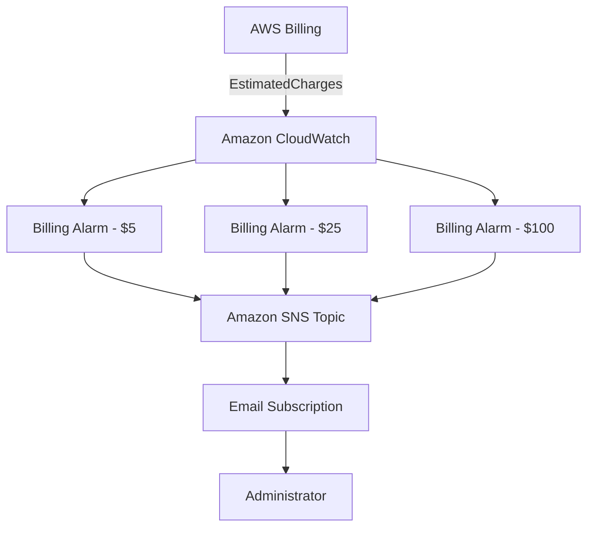

# AWS Billing Alarms with Terraform

Infrastructure as Code project that provisions AWS Billing Alarms using Terraform, Amazon CloudWatch and Amazon SNS to monitor estimated AWS expenses and send email notifications when predefined spending thresholds are reached.

## Architecture

The infrastructure uses **Amazon CloudWatch** to monitor AWS billing metrics and **Amazon SNS** to deliver notifications through an email subscription.



## Features

- **Three billing thresholds:** $5, $25 and $100 USD.
- **CloudWatch Metric Alarms:** Monitor the `EstimatedCharges` metric.
- **SNS Notifications:** Send email notifications when an alarm enters the `ALARM` state.
- **Terraform:** Infrastructure provisioned and managed declaratively.
- **Reusable SNS Topic:** All three alarms share the same notification channel.
- **Configurable Email:** The notification endpoint is supplied through a Terraform variable instead of being hardcoded in the infrastructure configuration.

## Infrastructure Components

| AWS Resource | Description |
|---|---|
| `aws_sns_topic` | Creates the billing notification topic. |
| `aws_sns_topic_subscription` | Subscribes an administrator email address to SNS. |
| `aws_cloudwatch_metric_alarm` | Creates the three billing alarms. |

### Billing Thresholds

| Alarm | Threshold | Metric |
|---|---:|---|
| Billing Alarm 1 | $5 USD | `EstimatedCharges` |
| Billing Alarm 2 | $25 USD | `EstimatedCharges` |
| Billing Alarm 3 | $100 USD | `EstimatedCharges` |

## CloudWatch Configuration

The alarms use the following CloudWatch metric:

| Property | Value |
|---|---|
| Namespace | `AWS/Billing` |
| Metric | `EstimatedCharges` |
| Dimension | `Currency = USD` |
| Statistic | `Maximum` |
| Period | `21600` seconds (6 hours) |
| Evaluation Periods | `1` |
| Comparison Operator | `GreaterThanOrEqualToThreshold` |

### Understanding EstimatedCharges

`EstimatedCharges` is an AWS-managed CloudWatch metric that represents the estimated accumulated charges for an AWS account.

CloudWatch evaluates this metric against the configured thresholds.

For example, if AWS reports estimated charges of $26:

- The $5 alarm enters the `ALARM` state.
- The $25 alarm enters the `ALARM` state.
- The $100 alarm remains below its threshold.

**Important:** AWS billing metrics are not real-time. Updates can be delayed, so notifications might not arrive immediately after spending reaches a threshold.

## Project Structure

```text
.
├── .gitignore
├── .terraform.lock.hcl
├── main.tf
├── output.tf
├── provider.tf
└── variables.tf
```

| File | Responsibility |
|---|---|
| `main.tf` | Defines the SNS resources and CloudWatch billing alarms. |
| `output.tf` | Exposes SNS and CloudWatch resource information. |
| `provider.tf` | Configures the AWS provider and required version. |
| `variables.tf` | Declares configurable Terraform input variables. |
| `.terraform.lock.hcl` | Locks provider dependencies. |
| `.gitignore` | Excludes Terraform state and local configuration files. |

## Prerequisites

- Terraform installed.
- AWS CLI installed.
- AWS credentials configured.
- An AWS account with permissions to manage CloudWatch, SNS and billing preferences.

## Configuration

The notification email is managed through a Terraform input variable.

### 1. Create a `terraform.tfvars` file

```hcl
billing_notification_email = "your-email@example.com"
```

This file is automatically excluded from version control through `.gitignore`, preventing personal configuration from being committed accidentally.

### 2. Initialize Terraform

Downloads the required provider dependencies.

```bash
terraform init
```

### 3. Validate the configuration

Checks Terraform configuration syntax and consistency.

```bash
terraform validate
```

### 4. Review the execution plan

Displays the infrastructure changes Terraform intends to apply.

```bash
terraform plan
```

### 5. Deploy the infrastructure

Creates the SNS topic, email subscription and three CloudWatch alarms.

```bash
terraform apply
```

Confirm the deployment when prompted.

## AWS Configuration Requirements

Before using billing alarms in a real AWS account:

1. Open **AWS Billing and Cost Management**.
2. Navigate to **Billing preferences**.
3. Enable **Receive CloudWatch Billing Alerts**.
4. Ensure the CloudWatch alarms are deployed in `us-east-1` (N. Virginia).
5. Confirm the SNS email subscription using the confirmation message sent to the configured email address.

Without enabling CloudWatch Billing Alerts, the `AWS/Billing` metrics might not be available.

**Note:** Terraform can create the email subscription, but the recipient must confirm it through the SNS confirmation email before notifications can be delivered.

## Testing and Verification

### Verify CloudWatch alarms

```bash
aws cloudwatch describe-alarms \
  --alarm-names \
    billing-alarm-5-dollars \
    billing-alarm-25-dollars \
    billing-alarm-100-dollars \
  --region us-east-1
```

### Verify SNS subscriptions

```bash
aws sns list-subscriptions \
  --region us-east-1
```

### Test SNS notifications

You can publish a test message directly to the SNS topic:

```bash
aws sns publish \
  --topic-arn YOUR_SNS_TOPIC_ARN \
  --message "Testing AWS billing notifications" \
  --region us-east-1
```

This verifies SNS message delivery independently of CloudWatch.

### Test CloudWatch alarm transitions

You can force an alarm into the `ALARM` state for testing:

```bash
aws cloudwatch set-alarm-state \
  --alarm-name billing-alarm-5-dollars \
  --state-value ALARM \
  --state-reason "Testing billing alarm notifications" \
  --region us-east-1
```

This tests the alarm state transition. Actual execution of alarm actions depends on the environment and CloudWatch implementation.

**Note:** Testing with an AWS emulator such as Floci does not reproduce actual AWS billing metrics. The `EstimatedCharges` metric must be validated in a real AWS account.

## Terraform Outputs

After deployment, Terraform exposes:

- `topic_arn`: SNS notification topic ARN.
- `topic_subscription_email`: Configured notification email.
- `alert_5dollars_arn`: ARN of the $5 billing alarm.
- `alert_25dollars_arn`: ARN of the $25 billing alarm.
- `alert_100dollars_arn`: ARN of the $100 billing alarm.

## Cleanup

To remove all resources created by this project:

```bash
terraform destroy
```

Confirm the operation when prompted.

---

**Technologies:** AWS · Terraform · Amazon CloudWatch · Amazon SNS · Infrastructure as Code
